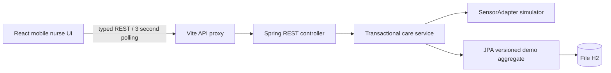

# Architecture

React Router owns navigation. A typed fetch client reports errors and refreshes the authoritative state after writes; background polling reconnects automatically. Note form state remains local while observations refresh. No UI-only clinical state mutations exist.

The backend owns assignments, task transitions, rounds ranking, draft/confirmed state, provenance, sensor candidates, and audit events. Nurse identity is the fixed local demo persona `nurse-demo`. Each patient read or mutation validates the assignment. UI unit switching models separate L&D and ICU deployments, not a real simultaneous cross-unit assignment. `/api/state` is an aggregate endpoint exposing all this demo persona's synthetic assignments; the UI restricts each unit view.

Implementation choice: to keep reset and linked task/chart writes atomic in the small hackathon dataset, JPA stores a versioned JSON demo aggregate in a single H2 CLOB. This keeps the requested stack and durable database, but is intentionally not a normalized production clinical database. Commands use a service transaction and optimistic row version. One local backend process is supported. Separate indexed entity tables, migrations, pagination across the aggregate endpoint, and real authenticated sessions remain production work.

UUIDs identify newly created observations and events; seeded patients/tasks have stable IDs. Seed due times are relative to reset time. Demo scenarios use no background timer, making the recording sequence repeatable. Database survives backend restart; reset intentionally recreates synthetic records and clears notes. UTC instants are displayed in the browser's local timezone.

Clinical provenance has three distinct layers: simulated source observation, derived movement candidate (prototype heuristic), and nurse-confirmed care. Confirming a movement never completes its task. Task completion with verified movement and chart creation occur in one transaction. Chart confirmation alone never completes a task. Corrections append new linked entries.

`APP_DEMO_MODE=false` rejects all demo data/command endpoints; health and context remain readable. The backend binds loopback, and Vite proxies same-origin API requests. There is no production authentication, EHR, external gateway, or AI dependency. API errors include status, message, UTC timestamp, and correlation ID. Transport failure leaves the loaded UI and unsaved narrative available, with Retry connection.
