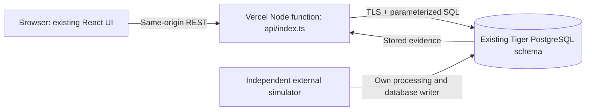

# Vercel + existing Tiger PostgreSQL

## Deployment

Deploy the repository root on `feature/vercel-tiger` as a standard Vite application. The source is `src/`, the entry HTML is root `index.html`, and one package/lockfile supplies the normal commands: `npm run dev`, `npm run build`, and `npm run preview`. Vercel's Vite preset detects the build command and `dist/` output automatically. The minimal `vercel.json` retains the Vite framework and routing needed for the existing API and React deep links. There are no custom build scripts, Vercel CLI dependency or nested workspace. No React/API source files were changed to normalize the tooling.

Add these **server-side** environment variables for the intended preview/production scope:

| Variable | Value |
|---|---|
| `DATABASE_URL` | `postgresql://HOST:PORT/tsdb?sslmode=verify-full` without embedded credentials when using the separate variables below |
| `SPRING_DATASOURCE_USERNAME` | Existing Tiger role |
| `SPRING_DATASOURCE_PASSWORD` | Current private Tiger password |
| `APP_AUTH_ENABLED` | Defaults to `false` temporarily; set `true` to restore password sessions |
| `APP_ACCESS_PASSWORD` | Required only when auth is enabled: random demo password, at least 24 characters |
| `APP_SESSION_SECRET` | Required only when auth is enabled: a different random secret, at least 32 characters |
| `DB_SCHEMA` | `achillea`, the already initialized application schema |
| `DB_POOL_MAX` | Optional; defaults to 3 per warm function instance, maximum 20 |
| `APP_ORIGIN` | Optional exact HTTPS origin; configure separately for each deployment hostname |
| `DATABASE_CA_CERT` | Optional PEM CA for a private authority; normal publicly trusted Tiger TLS needs none |

`SPRING_DATASOURCE_URL=jdbc:postgresql://...` remains accepted instead of `DATABASE_URL`, so the previously shared five-variable setup works. The `SPRING_` names are compatibility aliases only; no Spring code runs. If both URLs exist, `DATABASE_URL` takes precedence. URL-provided credentials are supported, but separate secret settings are easier to rotate. TLS always verifies the certificate and hostname outside explicitly isolated loopback tests; a URL's `sslmode=require`, `disable`, or Java `sslfactory` cannot turn verification off.

Do not set `ACHILLEA_TEST_MODE` on Vercel or point a preview containing tests at integration data. Do not put database/application secrets in `VITE_*` variables. Do not commit real `.env*`, `.vercel` configuration or credential files. Rotate credentials previously shared in chat.

There is no deploy-time database migration, seed or reset. If the existing Tiger schema is absent, the API returns an error: it does not recreate it. Historical Flyway files are references, not a startup hook. Default schema `achillea` must already contain V1/V2 tables and the intended synthetic records. No Timescale extension/partition settings are changed or assumed.

The deployment URL's `/api/health` performs a PostgreSQL query. Open `/`, sign in, verify assigned lists, unit switching, histories, rounds, a chart draft/confirmation, and a linked amendment using intended synthetic demo records. A real deployment smoke test writes workflow records, so use an explicitly approved integration patient. No hosted smoke was run during this migration because current database/deployment credentials were unavailable.

References: [Vite](https://vite.dev/guide/), [Vercel Vite support](https://vercel.com/docs/frameworks/frontend/vite), [Node functions](https://vercel.com/docs/functions/runtimes/node-js), [rewrites](https://vercel.com/docs/routing/rewrites). PostgreSQL TLS parsing follows [node-postgres SSL guidance](https://github.com/brianc/node-postgres/blob/master/docs/pages/features/ssl.mdx).

## Runtime architecture and security

One function dispatches the existing REST paths, keeping the free-tier function count small. `server/db.ts` provides a reusable `pg` pool with Vercel pool lifecycle attachment. Reads run in read-only repeatable-read transactions; writes use encounter row locks plus existing unique constraints. Lock timeout is 3 seconds; statement timeout 15 seconds. Database errors return sanitized JSON; temporary resource/lock failures use 503 with `Retry-After: 1`. The function maximum duration is 30 seconds.

The fixed demo nurse must have both the patient assignment and an active synthetic encounter assignment in PostgreSQL. IDs and values use SQL parameters; schema names are validated before interpolation. Clinical responses and sessions are `no-store`. Shared-password login signs an eight-hour HttpOnly, SameSite=Strict cookie with a separate HMAC secret; cookies are Secure on Vercel/production. Mutations require the application header and reject foreign browser origins. No unrestricted CORS is enabled. A browser simulator no longer calls Achillea ingestion endpoints.

This is a demo access gate, not per-nurse hospital identity, fine-grained enterprise authorization or distributed login throttling. Put the preview behind appropriate Vercel access controls/rate limiting when sharing publicly. Rotating `APP_SESSION_SECRET` invalidates sessions; changing only the password does not invalidate already signed cookies before expiry. No database or private integration secret is embedded in the frontend bundle.

## Preserved endpoints

Session login is temporarily disabled by default: clinical routes accept requests without a password/cookie, and `/api/auth/session` reports `authenticated:true, authEnabled:false`. The UI shows neither login nor sign-out controls. No login secrets are required in this mode. With `APP_AUTH_ENABLED=true`, clinical routes require a session and only `GET /api/health` is public. `GET`, `POST`, and `DELETE /api/auth/session` then inspect, create and clear the session respectively. Login takes `{ "password": "..." }` and the `X-Achillea-Request: 1` header. Same-origin mutation checks and patient/workflow validation apply in both modes.

| Method | Paths | Behavior |
|---|---|---|
| GET | `/api/state`, `/api/workspace?unit=...` | Assigned compatibility snapshot or metadata-only workspace |
| GET | `/api/patients?unit=...&query=...`, `/api/patients/{id}` | Assigned patient lists/details |
| GET | `/api/patients/{id}/vitals?metric=...&from=...&to=...&limit=...` | SQL-filtered history, at most 500 |
| GET | `/api/patients/{id}/tasks`, `/chart`, `/devices` | Patient workflow/device views |
| GET | `/api/patients/{id}/orientation`, `/sensor-history` | Stored samples, classifications, connectivity history, chart links |
| GET | `/api/monitoring/updates?unit=...&patientId=...&since=...` | Inclusive receipt-time deltas and stable-ID frontend deduplication |
| GET | `/api/activity/summary`, `/api/events` | Existing activity grouping and original events; event list limit at most 500 |
| GET / POST | `/api/rounds`, `/api/rounds/explanation` | Deterministic priority/schedule/sequence and reason codes |
| POST / PATCH | `/api/chart/drafts`, `/api/chart/drafts/{id}` | Save/edit a draft with same-encounter evidence |
| POST | `/api/chart/drafts/{id}/confirm`, `/api/chart/{id}/amendments` | Explicit confirmation and linked append-only correction |
| POST | `/api/tasks/{id}/{action}` | Acknowledge, defer with reason, reorder future routine work, set priority, explicitly complete |
| POST | `/api/movements/{id}/review` | Explicit bedside review; changes only nurse review fields/history |
| POST | `/api/demo/tasks` | Schedule a nurse review; retained existing UI contract |
| GET | `/api/demo/context`, `/api/demo/presets` | Context reports external ownership; preset keys are empty |

Old ingestion, generation, preset execution and destructive reset routes return 410, with no writes. The unassigned demo census endpoint is not part of the deployed nurse API. Unknown API routes return JSON 404 rather than the SPA. SPA deep links resolve to `index.html`.

Chart drafts remain drafts until an explicit verified confirmation. Confirmed rows cannot be edited; amendments retain the original link even when edited as drafts. Task completion, linked confirmed chart, activity and movement consumption commit together. A movement cannot satisfy two completed tasks. The preserved database guard continues protecting confirmed charts. No sensor or classifier output alone verifies care.

## Data ownership

Achillea reads patients/encounters/assignments, devices, vitals, raw-derived histories, movement classifications, review reason codes and workflow history. It does not provision patients, reassign devices, calculate roll, classify turns, synthesize samples, advance streams or change their source times.

Achillea writes `care_tasks`, `task_transitions`, `chart_entries`, `chart_evidence_links`, `movement_reviews`, `movement_consumptions`, nurse-generated `activity_events`, and only `verification_status`, `reviewer_id`, `reviewed_at` on `movement_candidates`. Editing a draft replaces that draft's evidence links inside its transaction; it does not delete observations. There are no runtime schema mutations or resets. Consider a least-privilege role with SELECT on evidence, required workflow DML and column-level movement review UPDATE grants. Provisioning such a role is an operator action; no grants or production schema changes were executed here.

See [the simulator writer handoff](backend/SIMULATOR_STORAGE_HANDOFF.md) before connecting a new writer. Existing FKs and deferred integrity checks still apply.

## Local verification and isolated test records

Run `npm ci` and `npm run dev` from the repository root. That runs the default Vite CLI directly, with no account login or separate API process. Keep the existing `.env.local`; `vite.config.ts` loads its server settings without exposing them to the React bundle and mounts the unchanged API handler for development and preview. `npm run build` runs the standard `tsc -b && vite build`; `npm run preview` runs `vite preview`. Vite's normal port selection and React refresh behavior apply. The TypeScript app/node project configs and Vitest config are retained because they support the app, API and existing tests.

`npm run test:db` starts PostgreSQL from native local binaries, creates a temporary cluster under the OS temp directory and a random `achillea_test_*` schema, and applies unchanged V1/V2 bytes there. The existing Tiger schema is not a target. Set `PG_BIN` to the PostgreSQL bin directory; the existing Windows `embedded-pg/PG-*/bin` cache can also be discovered. No extension is required. The runner overrides hosted credentials and creates deterministic fixtures for six assigned patients plus an unassigned patient, both units, paired regions, historical readings, tasks and movement evidence. It runs API tests, builds the actual React assets, and runs component/HTTP tests through a test-only static/function adapter. This adapter exists only under `tests/`, not as an alternative application development server. It stops all test services afterward. Temporary database files remain for inspection.

Manual `npm run test:seed` and `npm run test:cleanup` require all of: `ACHILLEA_TEST_MODE=isolated`, loopback database host, `DB_SCHEMA=achillea_test_*` and that existing isolated structure. Set those process variables explicitly. Seed uses stable IDs with `ON CONFLICT DO NOTHING`; cleanup is repeatable and rejects unexpected patient identities. Both operate only on a separately prepared local test schema. Cleanup removes rows only in that schema; it never truncates or drops integration tables. Normal startup and Vercel builds never invoke these commands. Do not run the original Spring branch's reset/import tools against this integration database.

## Limits and remaining verification

All data is synthetic. Tests use PostgreSQL 14.22, while the earlier Spring migration verified Tiger PostgreSQL 18.6. This TypeScript version has not been connected to live Tiger or deployed to a Vercel account during implementation. The actual external writer remains a separate team's responsibility.

Existing compatibility snapshots, activity grouping, orientation history and initial polling can still become large. Vital/event history is bounded; incremental frontend polling retains the original contract. There is no new retention/downsampling policy, time-series repartitioning, queue or claim of sustained production capacity. Keep hosted load and pool totals under observation before increasing patient/sample volume. Future Typesense would hold searchable copies; Tiger remains authoritative and search must not gate task/chart correctness.
