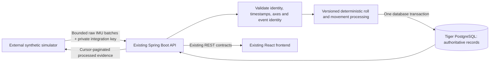
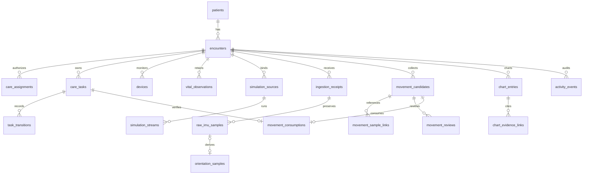

# Tiger migration implementation report

Implemented on `feature/tiger-simulation` from main `31d30da`. The existing Spring Boot application remains the only backend. Frontend source is unchanged. This branch is the reviewable implementation deliverable; no deployment or merge into main was performed.

## Architecture and ownership

Spring Boot owns validation, source quality, freshness, filtering, movement classification and existing nursing workflow rules. The database owns durable records, foreign keys, unique identities and transaction coordination. A movement remains evidence requiring nurse review; ingestion cannot confirm charts or complete care.

This diagram shows principal logical relationships; the SQL migrations are authoritative. V1 also contains departments, nurses, device assignments, movement reason codes and demo metadata. V2 adds ingestion and stream provenance. Both migrations use ordinary PostgreSQL tables, retaining exact evidence references and globally unique IDs. Timescale hypertables are deferred pending a compatible partition/unique-key/FK design.

Task/chart commands and ingestion serialize on the active encounter row. Task changes, linked chart/activity records and evidence consumption commit atomically. A unique movement-consumption constraint prevents reuse across concurrent requests; database guards also protect confirmed charts and encounter consistency. Different encounters can proceed independently. High-frequency ingestion batches inserts into receipts, raw samples and orientations, then persists changed stream/device/workflow metadata once per batch.

## Important files

- `backend/pom.xml`, `backend/src/main/resources/application.properties`, `backend/.env.example`: PostgreSQL driver, Flyway, pooling, TLS, readiness and opt-in initialization.
- `backend/src/main/resources/db/migration/V1__relational_workflows.sql` and `V2__external_simulation.sql`: version-controlled relational schema. Already applied migrations must not be edited.
- `RelationalStore.java`, `CareService.java`, `ApiController.java`, `ClinicalController.java`: typed JDBC persistence, scoped queries, database transaction locks and preserved REST behavior. Production `Store.java` and its JSON aggregate are removed.
- `DatabaseConfiguration.java`, `LegacyImportConfiguration.java`: startup validation, seed-if-empty and explicit optional legacy import.
- `SimulationService.java`, `SimulationController.java`, `SimulationAccessFilter.java`: bounded, authenticated development ingestion, deterministic processing, durable deduplication and retrieval.
- `backend/scripts/Start-Tiger.ps1`: credential-prompting local launcher; `simulator_client.py`: executable mock client; `ExportLegacyH2.java`: optional read-only legacy exporter; `VerifyTiger*.java`: hosted verification helpers.
- PostgreSQL regression fixtures and `SimulationPersistenceTest.java`: workflow, persistence, ingestion and concurrency coverage. Test-only legacy adapters are not application persistence.

## API and simulator status

- `POST /api/integrations/simulation/v1/observations`: schemaVersion, encounterId, sourceId, runId, timeScale and bounded samples containing eventId, timestamp or Unix-seconds t, and independent chest/pelvis axes. Uses `X-Simulation-Key` and configured source-to-encounter binding.
- `GET /api/integrations/simulation/v1/processed`: encounterId, sourceId, after and limit; returns stable identities, source/receipt/processing times, raw/derived evidence and movement review state.

Defaults are 250 packets and 262144 bytes per request; processed pages are at most 500 receipts. Exact retries return DUPLICATE; changed content under the same identity returns 409 and rolls back the batch. Out-of-order records remain stored without rewinding the filter. Simulation time drives filter/movement intervals; receipt time drives device freshness. Run IDs isolate reset/filter state. Do not interleave old and new runs for a single live source: device status reflects its latest traffic.

See [the full contract](simulator-integration.md) and [self-contained teammate handoff](SIMULATOR_HANDOFF.md). Only the supplied mock client was executed; the teammate's separate simulator is unavailable and has not been modified or certified compatible.

## Executed verification

| Check | Result |
|---|---|
| Original H2 regression baseline before changes | 44 passed |
| Final backend verify/package against disposable native PostgreSQL | 56 passed; zero failures, errors or skips |
| Frontend tests, including real HTTP against PostgreSQL-backed backend | 47 passed, including 9 HTTP tests |
| Frontend typecheck, lint and production build | Passed |
| Mock simulator POST, exact replay, processed GET and patient identity | Passed against local real HTTP |
| Single local batch of 250 paired packets / 500 raw region samples | 51824-byte payload accepted in 0.136 seconds, approximately 1835 packets/second |
| Real Tiger connection | PostgreSQL 18.6; encrypted TLS with certificate and hostname verification |
| Real Tiger V1/V2 migration | Applied successfully in dedicated `achillea` schema |
| Real Tiger application ingestion/replay/retrieval | Two packets accepted; two replay duplicates; correct patient retrieved |
| Real Tiger full application-context restart | Receipt and both raw region records survived |

The batch measurement is a single local loopback check, not sustained throughput or hosted capacity. No raw packets were intentionally dropped or downsampled. Local build logs and test results are under ignored `backend/target/`; they are not shipped source artifacts.

Hosted verification seeded the preserved synthetic scenarios only after finding an empty application dataset. It created a `cloud-smoke` source binding and synthetic smoke observations. It did not reset Tiger, edit existing H2 files, confirm care or complete tasks. The final hosted smoke also exercised the optimized batched ingestion implementation. Temporary verification servers have stopped; existing user servers were left alone.

Flyway warned that PostgreSQL 18 is newer than its advertised tested maximum of 17; migrations and restart verification nevertheless passed. No Timescale-specific operation, physical sensor, real browser/mobile session or hosted load test was verified.

## User steps and remaining scope

1. Rotate the database password shared in chat. Credentials are not saved in project files.
2. With Java 21 selected, run from the repository root: `./backend/scripts/Start-Tiger.ps1 -EnableSimulation`. The verified JAR is already built at `backend/target/tiger/achillea-0.1.0.jar`; rebuilding uses `mvn -f backend/pom.xml '-Dachillea.build.directory=target/tiger' verify`.
3. At the prompts supply a PostgreSQL JDBC URL without a password, database username, rotated password and a new private simulator key of at least 24 characters. Use `sslmode=verify-full&sslfactory=org.postgresql.ssl.DefaultJavaSSLFactory` in the JDBC URL. The existing Tiger schema is already initialized; do not request a reset. Default backend URL is `http://127.0.0.1:8080`; choose `-Port 8081` if another backend already occupies 8080.
4. Give the simulator teammate the handoff document, backend base URL and simulator key through a private channel. The simulator never needs the database password. Configure additional source bindings as documented.

There are no remaining blockers to the implemented backend path. The actual teammate client must still adopt and verify the proposed contract. Deployment authentication, network exposure, least-privilege account provisioning, sustained hosted load validation and real clinical/device use are outside this synthetic demo implementation. Compatibility snapshots can still grow large; scoped reads and bounded integration history improve the main paths without claiming unrestricted scaling.

Typesense is intentionally absent. A future search integration should index searchable copies from authoritative Tiger records, keep access enforcement in Spring Boot and consider a transactional outbox. Search availability must never control chart/task correctness.
